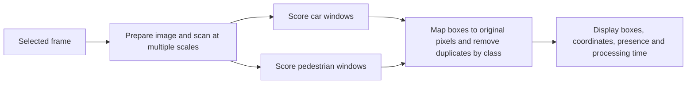

# Car and Pedestrian Detection in Image Frames

## Project goal

The project will take a single image frame and find the cars and pedestrians in it. The result will show the original image with a labeled box around each detected object, the box coordinates in pixels, and the time it took to process the frame. It will also display **Car present** and **Pedestrian present**, each derived from whether the corresponding model found any objects.

The central experiment is to measure how accurately two locally trained models can find and locate objects while keeping processing time low on the computer used for the demonstration. The demo will use a few selected frames. A larger set of unseen frames will be used to measure accuracy and speed.

## How the two AIs learn

| Model | Positive training examples | Negative training examples |
| --- | --- | --- |
| Car classifier | Crops that contain a car. The UIUC side-view dataset is the starting point. | Background windows and windows containing other objects, including pedestrians, without a car. |
| Pedestrian classifier | Crops that contain a pedestrian. The Daimler pedestrian classification dataset is the planned starting point. | Background windows and windows containing other objects, including cars, without a pedestrian. |

Each model will use **Histograms of Oriented Gradients (HOG)** and a **linear Support Vector Machine (SVM)** as the initial approach. HOG summarizes the directions of edges in different parts of a window. The SVM learns which combinations of those features distinguish positive from negative examples and assigns a score to each new window. Each classifier learns its own decision rule and can use a window shape suited to its category. The car model can use a wider window, while the pedestrian model can use a taller one.

Training happens separately from detection. The local Python application will load the two saved models and use OpenCV and NumPy to process selected frames.

## How the system finds the coordinates

1. **Load the original frame.** Record its width and height and prepare a grayscale image for feature extraction.
2. **Scan the frame at several scales.** Move a window across the image for each classifier. Repeat at different scales so the detector can find objects that occupy different amounts of the frame.
3. **Score the windows.** Extract HOG features for each window and run its classifier. Keep windows that score above the threshold for that class and map them back to pixel coordinates in the original image.
4. **Remove duplicate boxes.** A single object may score well in several overlapping windows. Apply non-maximum suppression separately for cars and pedestrians. It keeps higher-scoring boxes and removes lower-scoring boxes that overlap them substantially.
5. **Show the result.** Draw the remaining boxes and class labels on the original frame. Display their coordinates, the two presence answers, and the processing time.

### What the coordinates mean

Each box is `(x, y, width, height)` in original-image pixels. The origin `(0, 0)` is the upper-left corner of the frame. `x` increases to the right and `y` increases downward. The `x` and `y` values identify the upper-left corner of the box. The width and height describe how far the box extends.

For example, a 1280 × 720 frame with two cars and one pedestrian could produce these illustrative results.

| Object | x | y | Width | Height |
| --- | ---: | ---: | ---: | ---: |
| Car | 80 | 300 | 260 | 130 |
| Car | 670 | 320 | 200 | 105 |
| Pedestrian | 1020 | 260 | 62 | 170 |

Both presence answers would be **Yes**. A class with zero returned boxes would display **No**.

## Data and evaluation

The crop datasets provide an initial test of whether the models can recognize each category in a small region. To develop and evaluate the full-frame detector, collect representative scenes and label every target object with its class and bounding box. Include different object sizes, viewpoints and backgrounds. The data should cover frames with cars only, pedestrians only, both classes, and neither. The demo should also include a frame with multiple objects of the same class.

Split the frames by source scene or recording session so neighboring frames stay together. Use the training set to fit the models, the validation set to tune the scan and thresholds, and a held-out test set for final results.

- **Object detection.** Match predicted and labeled boxes one-to-one within each class. Use intersection over union (IoU), the area two boxes share divided by the area they cover together, to decide whether the predicted location is close enough. Choose a match threshold before final testing and report precision, recall, F1, missed objects, and false detections for each class.
- **Frame-level presence.** Check how often both Yes/No answers are correct on the same frame. Review examples where the detector misses a small object, fires on background, or places a box poorly.
- **Speed.** Measure the time from loading the selected image to producing its annotated result. Report model initialization separately, along with the computer, image resolution, median processing time, and processing times for slower frames. Set a numeric speed target after the first representative benchmark.

## Current progress and development plan

The current car prototype was trained on **840 UIUC crops** and correctly classified **209 of 210 held-out crops**. It missed one car and assigned zero false car labels in that test. Its command-line output is a single `Car` or `No car` label for the supplied image. The pedestrian model, the multi-scale scan, and coordinate output are planned work. The crop result provides a baseline for car recognition. Full-frame detection accuracy and processing time will be measured separately. [Current prototype](README.md#this-weeks-experiment) · [Recorded metrics](results/classification_metrics.json)

1. Select representative frames, define the target image conditions, and identify the computer for the demo.
2. Prepare pedestrian crops and annotated full frames, then create the training, validation, and test splits.
3. Train and evaluate both classifiers on crops. Build the multi-scale detector, then tune box filtering on the validation scenes.
4. Build the image-selection demo with annotated frames, coordinate output, presence labels, and timing.
5. Evaluate the completed detector on held-out scenes and document where both models succeed or miss objects.

The earlier proposal draft describes the frame-level presence workflow. This overview adds a box for each detected object and defines how the system obtains and evaluates the coordinates. [Original proposal outline](proposal_plan.md)
