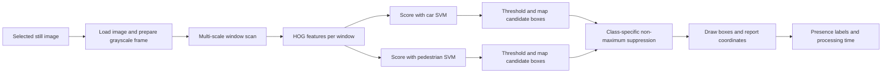

# Re-vision: Car and Pedestrian Detection in Still Images

**Project proposal — first draft**  
**Status:** Draft for review  
**Working title:** An Intelligent Computer Vision System for Vehicle and Pedestrian Detection Using Selective Image-Region Processing

## 1. Abstract

This project proposes a local computer-vision application that analyzes a selected still image and detects cars and pedestrians. The application will mark each detected object with a labeled bounding box, report the box coordinates in image pixels, summarize whether each class is present, and show the processing time. The experiment will evaluate detection accuracy and runtime on representative images using a computer selected for the demonstration.

The initial approach uses Histograms of Oriented Gradients (HOG) to describe local edge and shape patterns and a linear Support Vector Machine (SVM) to classify image windows. A separate binary classifier will be trained for each object class. The current project has a working car crop-classification baseline: it correctly classified 209 of 210 held-out crops. That result is an early classification result, not a measurement of full-image object detection. Pedestrian classification and localization are planned work.

## 2. Background and motivation

Finding objects in an image is useful for understanding a scene, but a practical detector must do more than decide whether an image contains a category. It should identify where each object appears, work across different object sizes, avoid returning many duplicate boxes for the same object, and complete processing quickly enough for the intended demonstration.

This project focuses on two categories: cars and pedestrians. It will test whether lightweight, locally trained HOG/SVM classifiers can provide useful detection results on selected still images while keeping computation modest. A local approach also allows the demonstration to run without sending images to a remote service.

## 3. Project objectives and research question

The system will:

1. Accept a selected still image frame.
2. Detect zero or more cars and pedestrians.
3. Draw a labeled box around each returned object.
4. Report each box as `(x, y, width, height)` in original-image pixels.
5. Show independent **Car present** and **Pedestrian present** answers.
6. Report image-processing time and document the computer and input resolution used.

The central research question is: **How accurately can locally trained HOG/linear-SVM detectors locate cars and pedestrians in representative still images while maintaining low processing time on the demonstration computer?** The numerical speed target will be set after a representative benchmark and selection of the runtime device.

## 4. Intended user workflow and demonstration

The user selects an image and starts analysis. The application displays the image with detected boxes and labels, a list of coordinates, the two class-presence answers, and elapsed processing time. The initial demonstration will use a small set of representative images covering:

| Scene contents | Car present | Pedestrian present |
| --- | --- | --- |
| Cars only | Yes | No |
| Pedestrians only | No | Yes |
| Both categories | Yes | Yes |
| Neither category | No | No |

Additional examples should include more than one object of a class and objects at different apparent sizes. These demonstration images will illustrate the workflow; a larger held-out set will be used for quantitative evaluation.

## 5. Proposed algorithm

### 5.1 Model training

The starting design trains two independent binary classifiers: one for cars and one for pedestrians. Each model uses positive windows containing its target category and negative windows without that category. Negative examples should include background and confusing non-target objects; for example, pedestrian windows are useful hard negatives for the car model and vice versa.

For every labeled training window:

1. Convert or load the window in grayscale and resize it to the model's fixed window dimensions.
2. Compute a HOG descriptor. HOG calculates image gradients and summarizes edge orientations in local cells, producing a feature vector that captures shape and contour information.
3. Train a linear SVM on the labeled HOG vectors. The learned decision boundary separates target windows from non-target windows.
4. Save the trained model and record its training configuration and data split.

Car and pedestrian windows may use different dimensions to reflect their typical shapes: wider windows for cars and taller windows for pedestrians. The dimensions and HOG/SVM settings will be chosen after examining the target images and validated on training/validation data.

### 5.2 Full-image inference and localization

At inference, load the original image and create a grayscale copy for feature extraction. For each class, scan windows across the image at several scales. Each window is described with the same HOG configuration used for training and scored by that class's SVM. Retain windows whose scores pass a class-specific threshold, then map their positions and sizes back to coordinates in the original image.

A single object can produce several overlapping candidate windows. Apply non-maximum suppression separately for each class: rank boxes by score, keep a high-scoring box, and discard lower-scoring boxes that overlap it beyond a chosen threshold. The remaining boxes form the detections for that class.

For a returned box, `(x, y)` is its upper-left corner, `width` is its horizontal extent, and `height` is its vertical extent. The origin `(0, 0)` is the image's upper-left pixel; x increases to the right and y increases downward. Presence is derived from the final detections: a class is present if at least one box remains after filtering.

HOG/linear-SVM sliding-window detection is the proposed initial method. The current classifier script operates on a supplied crop and returns a single class label; the scan, localization, suppression, pedestrian model, and visual interface described above are proposed components and have not yet been implemented.

## 6. Data collection and preparation

The current car experiment uses UIUC car and non-car crops as a starting point. The project records 550 positive and 500 negative source crops, and the current experiment uses 840 examples for training and 210 for testing. These are small grayscale side-view crops and are suitable as an initial classifier baseline, but they do not by themselves represent arbitrary full scenes.

The proposal identifies the Daimler pedestrian classification dataset as the starting source for pedestrian crops. Its source groups should be preserved when preparing data. The associated license and research-use conditions must accompany any prepared copy and be checked before redistribution.

The full-image detector also requires representative scene images with object-level bounding-box annotations. The final data should cover varied object sizes, viewpoints, backgrounds, and all four presence combinations shown above. Where possible, split data by source scene or recording session before extracting or augmenting frames. Neighboring frames and augmented versions of the same source should stay in one partition to reduce leakage between training and evaluation.

Use three partitions:

- **Training:** fit the HOG/SVM models.
- **Validation:** choose window sizes, scan stride and scales, class thresholds, and non-maximum-suppression settings.
- **Test:** provide a final evaluation on scenes not used to fit or tune the detector.

The test partition must remain untouched during model and threshold selection.

## 7. Evaluation plan

### Object detection accuracy

Evaluate cars and pedestrians separately. Match predicted boxes to ground-truth boxes one-to-one within each class using intersection over union (IoU), defined as the area of overlap divided by the area of the union of two boxes. Select and document the IoU matching threshold before final testing. Report precision, recall, F1 score, false detections, and missed objects for each class, along with representative success and error examples.

### Frame-level presence

For each test image, compare the predicted car-present and pedestrian-present answers with the image labels. Report per-class presence accuracy and the proportion of frames where both answers are correct. Inspect misses and false alarms by image conditions such as object size, viewpoint, occlusion, and background.

### Processing time

Measure end-to-end image processing time from loading/preparing the selected image through producing the annotated result. Report model initialization separately. Record the computer, image resolution, model settings, and the median and slower-frame timings across the same evaluation set. Establish a numeric target after the first benchmark on the chosen computer; avoid claiming a speed target before measuring it.

## 8. Current prototype and preliminary result

A car-only HOG/linear-SVM crop classifier is implemented in Python using OpenCV and NumPy. The saved baseline was trained on 840 UIUC crops and evaluated on 210 held-out crops. It classified 209 correctly: 109 of 110 car crops and 100 of 100 non-car crops. This corresponds to 99.52% accuracy on that crop split, with one false negative and no false positives in the recorded results.

This preliminary score is limited to the stated crop dataset and split. It does not establish generalization to full photographs, localization quality, pedestrian performance, or processing speed. The implemented command-line prediction currently returns a single `Car` or `No car` label for an input crop.

## 9. Development plan

| Stage | Work | Reviewable result |
| --- | --- | --- |
| 1. Define demonstration conditions | Select representative images, target resolution, runtime computer, and submission date | Image requirements and confirmed constraints |
| 2. Prepare data | Review source terms, prepare pedestrian crops, annotate representative full scenes, and create grouped train/validation/test splits | Documented, reproducible datasets and annotations |
| 3. Train and validate classifiers | Train car and pedestrian HOG/SVM models; inspect validation errors | Saved models, settings, and crop-level metrics |
| 4. Implement localization | Add multi-scale window scanning, score thresholds, coordinate mapping, and class-specific suppression | Detector that returns boxes per class |
| 5. Build the demonstration | Add image selection and display boxes, coordinates, presence answers, and timings | Usable local still-image demo |
| 6. Evaluate and report | Evaluate on held-out scenes, benchmark runtime, summarize errors and limitations | Final metrics, examples, and written report |

Dates and numeric performance goals will be added once the submission deadline and demonstration computer are confirmed.

## 10. Tools and implementation

The prototype uses Python, OpenCV, and NumPy. OpenCV provides image processing, HOG support, and SVM functionality. The project runs locally and stores trained models and experiment results in the project folder. The current setup and commands are documented in `README.md`; dependencies are listed in `requirements.txt`.

## 11. Expected outcome and limitations

The expected outcome is a working local prototype that detects cars and pedestrians in selected still images, annotates the detections, reports pixel coordinates and class-presence results, and provides measured processing times. Its performance will be reported on held-out scenes rather than inferred from crop-level accuracy.

The initial HOG/SVM method is a deliberately simple baseline. Results may be limited by small training datasets, differences between cropped training images and full scenes, object scale and viewpoint variation, occlusion, and confusing backgrounds. The project will document these limitations and use measured errors to guide future work.

## 12. References

1. Dalal, N. and Triggs, B. “Histograms of Oriented Gradients for Human Detection.” CVPR, 2005. [Paper](https://lear.inrialpes.fr/people/triggs/pubs/Dalal-cvpr05.pdf)
2. UIUC Image Database for Car Detection. [Dataset page](https://cogcomp.seas.upenn.edu/Data/Car/)
3. Daimler pedestrian classification benchmark. [Dataset README and benchmark information](http://www.lookingatpeople.com/data/Daimler/pami06-munder-gavrila/README_benchmark.txt)
4. scikit-learn documentation, grouped cross-validation iterators. [Grouped evaluation guidance](https://scikit-learn.org/stable/modules/cross_validation.html#cross-validation-iterators-for-grouped-data)
5. Project implementation and experiment notes: [`PROJECT_OVERVIEW.md`](PROJECT_OVERVIEW.md), [`proposal_plan.md`](proposal_plan.md), [`README.md`](README.md), and [`results/classification_metrics.json`](results/classification_metrics.json).

---

## Items to confirm in the next draft

- Proposal submission date and required formatting/template.
- Demonstration computer and target image resolution.
- Which source and newly collected images may be used and redistributed.
- Required report language and expected academic level.
- Whether the final scope requires only presence classification or object-level bounding-box detection. This draft follows the current project overview and includes bounding boxes.
