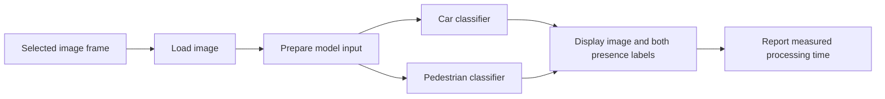

# Proposal planning draft

Working title — **Efficient Car and Pedestrian Classification in Image Frames**

This is a planning outline for the written proposal. It follows the supplied examples' progression through the problem, algorithm, system workflow, testing and development schedule.

## Confirmed scope and remaining decisions

| Decision | Current position |
| --- | --- |
| Categories | Both cars and pedestrians |
| Training approach | Train our own classifiers using labeled examples |
| Demonstration | A few selected image frames |
| Frame content | Representative examples will establish object size, viewpoints, background and resolution |
| Submission date and runtime device | To be recorded before assigning dates and a hardware-specific speed target |

## 1. Background and project objective

Explain the challenge of recognizing cars and pedestrians accurately with low processing cost. Introduce image classification, training and prediction, and the relationship between accuracy, model complexity and prediction time.

The proposed system will accept an image frame and produce two independent answers, whether a car is present and whether a pedestrian is present. Both answers refer to the same frame.

The central experimental question is how accurately classifiers trained for these two categories can recognize their presence while maintaining low processing time per frame on the chosen computer.

## 2. User workflow and visible result

The user selects an image frame and starts classification. The application displays the original image, its car and pedestrian labels, and the measured processing time.

The demonstration can use four to eight frames covering these four cases.

| Example content | Car present | Pedestrian present |
| --- | --- | --- |
| Cars alone | Yes | No |
| Pedestrians alone | No | Yes |
| Cars and pedestrians together | Yes | Yes |
| Neither category | No | No |

The proposal will include a sketch of this screen and a description of the selected example frames. A larger held-out set will support quantitative evaluation.

## 3. Algorithm and model development

Use Histograms of Oriented Gradients (HOG) and a linear Support Vector Machine (SVM) as the initial method. HOG computes image features from local gradients. SVM training learns the decision boundary from labeled examples. The existing car experiment provides a concrete starting point. [HOG and linear SVM paper](https://lear.inrialpes.fr/people/triggs/pubs/Dalal-cvpr05.pdf)

Train one binary classifier for car presence and another for pedestrian presence. Each learns from its own positive and negative labels. At prediction time, both process the same selected frame.

Describe image preparation, HOG feature extraction, classifier training and conversion of predictions into the two visible labels. Select feature dimensions and training settings after inspecting representative input frames. The initial results will guide any later model changes.

## 4. Data preparation

For cars, UIUC supplies 550 positive and 500 negative training crops. Its small side-view images support a preliminary classification experiment. [UIUC dataset](https://cogcomp.seas.upenn.edu/Data/Car/)

For pedestrians, the Daimler classification dataset provides grayscale pedestrian and non-pedestrian crops with established training and test groups. A starter subset can use approximately 500 examples per class while retaining those source groups. Include its research-use license with any prepared copy. [Daimler dataset README](http://www.lookingatpeople.com/data/Daimler/pami06-munder-gavrila/README_benchmark.txt)

The selected image conditions determine the final data requirement. Wide scenes require representative full-frame training and evaluation examples. Those examples should cover cars alone, pedestrians alone, both together, and neither. Each image receives separate car-presence and pedestrian-presence labels.

Separate source scenes or recording sessions before splitting the data. Keep neighboring frames and augmented variants together. Preserve Daimler's established source groups. Use validation examples for model decisions and a separate held-out set for the final evaluation. [Grouped evaluation guidance](https://scikit-learn.org/stable/modules/cross_validation.html#cross-validation-iterators-for-grouped-data)

## 5. System architecture

The initial implementation can run locally in Python.

Explain each component's responsibility, the two trained model files, data labels and result measurements. Python, NumPy and OpenCV support the initial HOG/SVM implementation.

## 6. Evaluation and performance target

Measure precision, recall, F1, false positives and missed examples separately for cars and pedestrians on held-out inputs. Include representative correct and incorrect predictions. For scene images, also report how often both labels are correct together.

Measure the time to load and prepare a frame, run both classifiers and present the result. Report model initialization time separately. Record the computer, input resolution, model sizes, and median and slow-frame processing times across the evaluation set.

The speed goal is low response time for each selected frame. Establish a numeric target after the first representative-frame benchmark. The few demonstration frames illustrate the workflow, and the larger evaluation set provides the basis for accuracy and timing measurements.

Training-set size will be chosen for learning quality and experiment cost. Prediction speed will be evaluated with the trained model.

## 7. Preliminary progress

The car baseline has already been trained on 840 UIUC crops and evaluated on 210 held-out crops. It classified 209 correctly, with one missed car and zero false car labels. This is a preliminary result on side-view crops. Pedestrian classification and performance on representative scene frames remain to be measured. The recorded results are in [classification_metrics.json](results/classification_metrics.json).

## 8. Development milestones

| Phase | Reviewable result |
| --- | --- |
| Define input conditions | Selected example frames, image resolution and runtime computer |
| Prepare data | Labeled examples, source documentation and reproducible splits |
| Train classifiers | Car and pedestrian models trained on the prepared examples |
| Validate and refine | Error examples, validation results and measured prediction cost |
| Build the frame demo | Image selection, both visible labels and timing measurements |
| Evaluate and document | Held-out frame results, limitations, final demonstration and written report |

Assign dates after confirming the submission deadline. Allocate time for matching the training data to the selected frame conditions.

## Proposed written-proposal order

Introduction and motivation → project description and user workflow → theoretical background → algorithm and training method → datasets and preparation → architecture and processing diagram → evaluation and demonstration plan → technologies → development timetable → references.
